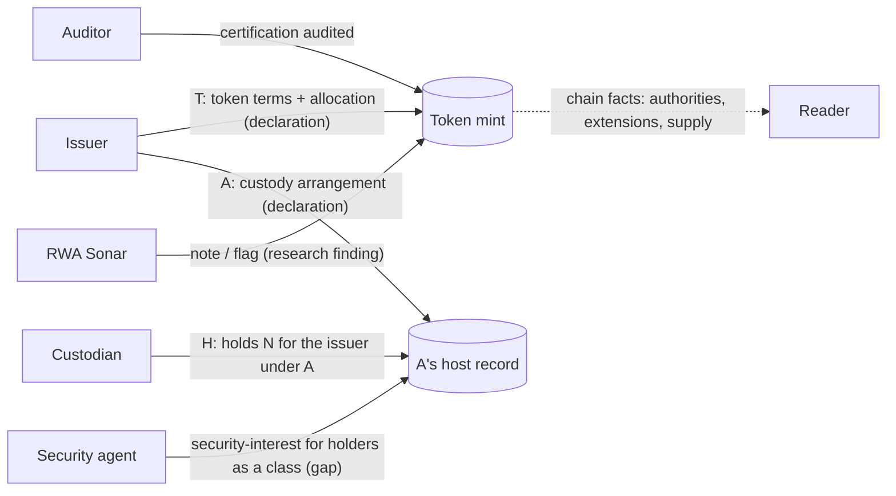

<!-- Method, results and Tokenizario gaps from restating every RWA Sonar programme and token as typed attestations ("X says Y about Z") in Tokenizario's vocabulary v3. Built 2026-10-13. -->
# RWA Sonar, restated as attestations

Tokenizario's thesis is that everything in tokenization can be said as typed, signed attestations: **X says Y
about Z**. RWA Sonar is a database of how real tokenized products work. This document records what happened when
every programme and token in the database was restated in Tokenizario's vocabulary v3. It shows how much of each
structure its own parties already say. Where the vocabulary falls short, the restatement records a gap instead of
inventing an answer.

Built 2026-10-13 from the research as dated in each file. The figures below come from that build. Rebuild with
`npm run rwa:restatements`, which writes `rwa-restatements.json`; that file always has the current numbers.

## Files

| File | What it is |
|---|---|
| [`data/tokenizario-vocabulary.json`](data/tokenizario-vocabulary.json) | A dated snapshot of v3: 32 types, predicates, events, roles, the A/H/T fungible documents and what the reader can read. `restatement.test.js` compares it with Tokenizario's `vocabulary.ts` when `TOKENIZARIO_REPO` points at a checkout. |
| [`data/attestation-schema-map.json`](data/attestation-schema-map.json) | Each of RWA Sonar's 88 attestation schemas and 73 finding schemas, translated into v3: exact, approximate, chain fact, reading, absence, terms, gap or out of scope. Every attestation and finding instance in the database is restated through it automatically. |
| [`data/restatements/<id>.json`](data/restatements/) | One hand-written restatement per programme (40). Each lists the parties, the statements the structure needs (signer, type, about, what it says), what the signer does with that statement today, chain facts, what stays in terms and law, a buyer's recipe and a verdict. |
| [`data/tokenizario-gaps.json`](data/tokenizario-gaps.json) | 27 things v3 cannot say, each with the products that need it and a proposed change. |
| [`lib/restatement.js`](lib/restatement.js), [`build-restatements.mjs`](build-restatements.mjs) | Validation, readiness counts, recipe checks, instance mapping, coverage. The build fails if any research product, dossier, catalogue entry, universe token or schema is left unrestated. |

## Method

1. **Structure first.** For each programme the restatement writes the statements that its real parties would sign
   if they used Tokenizario. Existing fungible tokens use the A/H/T path that `/fungible` implements:
   - **A:** the client's custody arrangement naming the custodian, a `declaration`.
   - **H:** the custodian's dated holdings under A, a `holds`.
   - **T:** the issuer's token terms with an explicit allocation, a `declaration`.

   Around these come `status` (backed, allocated), `certification` (audited, corporate action), `security-interest`,
   `register-entry`, `credential`, `valuation` and RWA Sonar's own findings as a researcher's `note` or `flag`.
2. **What the signer does today**, per statement:
   - `onchain`: the signer publishes it under its own key.
   - `published`: the signer publishes it under its own name.
   - `reported`: only someone else says it.
   - `not-published`: the signer is named, but nobody publishes the statement.
   - `unnamed`: the party who would have to sign is not identified.
   - `not-checked`: a public register probably holds it, but this restatement did not read it.
3. **Recipe check.** Each recipe is checked as if every party signed what it already says, that is, statements
   whose state is `onchain` or `published`.
4. **Invent nothing.** A value v3 lacks is used only as an explicit proposal (`proposed: true`) tied to a gap. The
   facts come from RWA Sonar's research and dossiers, Tokenizario's `mechanisms.ts`, and one chain read of 12
   Solana mints (finalized slot 456350748, 13 October 2026).

## Results

**Coverage.** 40 programmes cover 27 research products (21 existing and 6 new from Tokenizario's research), all 13
issuer dossiers, all 32 catalogue entries and all 1,183 universe tokens. 478 attestation and finding instances in
the database were restated through the schema map: 95 exact, 150 approximate, 73 chain facts, 53 absences, 57 gaps,
28 terms, 9 readings and 13 out of scope.

**Verdicts.** 1 good, 30 partial, 6 poor, 3 not a token.

**Who already says their part.** The 40 structures need 499 statements:

| State | Statements |
|---|---|
| published | 249 |
| onchain | 5 |
| reported | 65 |
| not-published | 60 |
| unnamed | 96 |
| not-checked | 24 |

Without RWA Sonar's own 63 notes, the parties themselves say 192 of 436 (44%). The split by role is stark:

| Role | Says its part | Of |
|---|---|---|
| issuer | 130 | 200 |
| platform | 21 | 23 |
| custodian | 7 | 48 |
| auditor | 6 | 36 |
| transfer agent | 7 | 23 |
| trustee or security agent | 7 | 14 |
| administrator | 1 | 12 |
| regulator | 6 | 31 |
| counsel | 0 | 7 |
| insurer | 0 | 6 |

Issuers describe their products. The parties whose word makes a token worth more than the issuer's own almost never
publish in their own name.

**Recipes.** None of the 38 buyer recipes would be met even if every party signed what it already says. Only 43 of
their 151 ingredients are said by the right signer. The usual missing pieces are the custodian's own holdings, an
independent examination and a registrar's entry for the holder's wallet.

**Readable today.** Tokenizario's reader handles classic SPL only. Only 4 programmes have such a token: USDC, USDY,
OUSG (supply 0 on Solana) and TRCH1. Every tokenized stock and 8 of the 12 researched Solana fund, gold and dollar
mints are Token-2022.

| Programme | Fit | Readable | Statements | Said by signer | Reported only | Unnamed or unpublished | Recipe said |
|---|---|---|---|---|---|---|---|
| BAXUS bottle NFT | good | no | 10 | 4 | 0 | 4 | 1/3 |
| Opening Bell by Superstate | partial | no | 13 | 10 | 0 | 3 | 2/4 |
| Tessera T-Tokens | partial | no | 16 | 12 | 0 | 4 | 2/4 |
| Spiko USTBL | partial | no | 13 | 9 | 3 | 0 | 2/5 |
| Franklin FOBXX (BENJI) | partial | no | 12 | 8 | 1 | 1 | 2/5 |
| Securitize SECZ | partial | no | 12 | 8 | 0 | 3 | 2/3 |
| Bullish BLSH | partial | no | 11 | 7 | 2 | 2 | 2/4 |
| Obsidian xGLDB | partial | no | 8 | 5 | 1 | 2 | 2/4 |
| Shift Series tokens | partial | no | 16 | 10 | 1 | 5 | 2/3 |
| Securitize Stocks (CETs) | partial | no | 13 | 8 | 0 | 4 | 1/4 |
| Ondo USDY | partial | yes | 13 | 8 | 3 | 1 | 1/4 |
| Backpack Securities (SPCX) | partial | no | 15 | 9 | 1 | 5 | 1/4 |
| Tether Gold | partial | no | 12 | 7 | 1 | 4 | 2/3 |
| TER Gold | partial | no | 14 | 8 | 0 | 5 | 2/4 |
| VanEck VBILL | partial | no | 14 | 8 | 3 | 3 | 1/5 |
| Ondo Global Markets | partial | no | 16 | 9 | 4 | 2 | 2/4 |
| Paxos Gold | partial | no | 13 | 7 | 0 | 4 | 2/4 |
| Circle USDC | partial | yes | 13 | 7 | 3 | 1 | 3/4 |
| Kraken xStocks | partial | no | 14 | 7 | 5 | 1 | 1/5 |
| Jurassic Finance TRCH1 | partial | yes | 13 | 6 | 0 | 7 | 1/5 |
| Janus Henderson JTRSY | partial | no | 13 | 6 | 1 | 6 | 1/4 |
| Cropto CROW | partial | no | 9 | 4 | 0 | 3 | 1/4 |
| OpenEden TBILL | partial | no | 14 | 6 | 2 | 6 | 1/4 |
| Cask Capital fraction | partial | no | 10 | 4 | 0 | 6 | 1/4 |
| WisdomTree WTGXX | partial | no | 13 | 5 | 1 | 4 | 0/4 |
| Invesco USTB (ex-Superstate) | partial | no | 14 | 5 | 6 | 3 | 0/5 |
| Hamilton Lane SCOPE | partial | no | 12 | 4 | 2 | 6 | 0/4 |
| Apollo ACRED | partial | no | 12 | 3 | 3 | 5 | 0/5 |
| Ondo OUSG | partial | yes | 12 | 3 | 5 | 3 | 1/5 |
| BlackRock BUIDL | partial | no | 12 | 2 | 7 | 3 | 0/5 |
| Circle USYC | partial | no | 12 | 1 | 4 | 7 | 0/5 |
| RepublicX Mirror Notes | poor | no | 16 | 11 | 1 | 2 | 1/3 |
| PreStocks | poor | no | 15 | 10 | 0 | 5 | 0/3 |
| Felix USDhl | poor | no | 11 | 7 | 2 | 2 | 2/3 |
| Theo thBILL | poor | no | 12 | 7 | 0 | 5 | 1/3 |
| Remora Markets (wound down) | poor | no | 14 | 6 | 3 | 5 | 0/3 |
| Oro GOLD | poor | no | 11 | 3 | 0 | 8 | 0/3 |
| Ventuals (sunset) | not a token | no | 7 | 7 | 0 | 0 | – |
| LuxHub watch (devnet) | not a token | no | 10 | 2 | 0 | 8 | 0/3 |
| Uranium Digital | not a token | no | 9 | 1 | 0 | 8 | – |

"Poor" products are not hard to say. They are poor because what decides the holder's position has no identified
signer, or the issuer's own documents disclaim it. The restatement makes that visible as missing signers instead of
as vocabulary failures. BAXUS rates "good" because a single vaulted bottle on an NFT is the case v3 was built for.
Even so, it needs two proposals: insurance, and which record of the bottle counts.

## What Tokenizario needs: gaps, ranked by evidence

Priority 1 blocks a whole class of real products. Each count is how many programmes ran into the gap, how many
statements carry it, and how many RWA Sonar schemas hit it. The full text and proposals are in
[`data/tokenizario-gaps.json`](data/tokenizario-gaps.json).

| Gap | P | Programmes | Statements | Schemas |
|---|---|---|---|---|
| `issuer-key-binding`: nothing ties a signing wallet to the mint's own authorities (or the MPC provider that holds them) | 1 | 38 | 45 | 6 |
| `legal-characterisation`: too few claim kinds (registered holding, trust interest, secured or unsecured debt, contingent, LP interest, Article 8 entitlement, synthetic, rank, credit support) | 1 | 37 | 43 | 9 |
| `reader-scope`: the reader cannot read Token-2022, EVM, Hedera or XRPL | 1 | 35 | 39 | 17 |
| `class-beneficiary`: custody and charges cannot be held for the holders of a mint as a class | 1 | 11 | 12 | 0 |
| `legal-opinion`: no typed opinion (true sale, non-consolidation, enforceability, priority, reliance) | 1 | 8 | 8 | 13 |
| `court-order`: court orders and court-resolved replacement tokens have no typed form | 1 | 1 | 1 | 0 |
| `research-finding`: a researcher's dated finding, with its search scope, has no typed home | 2 | 40 | 63 | 3 |
| `eligibility`: who may hold, receive or redeem | 2 | 33 | 33 | 5 |
| `units`: shares, fund units, face value, other currencies | 2 | 29 | 74 | 0 |
| `roles`: transfer agent, trustee, administrator, insurer, oracle, counsel, regulator, GP, manager | 2 | 26 | 58 | 7 |
| `reserve-structure`: assets against liabilities over many chains, exclusions, allocated or unallocated | 2 | 24 | 33 | 6 |
| `authoritative-record`: which register prevails; nominee holdings | 2 | 22 | 22 | 5 |
| `affiliation`: common control between signers | 2 | 21 | 25 | 3 |
| `oracle-feed`: continuous on-chain or signed-report attestations | 2 | 8 | 9 | 3 |
| `reserved-powers`: powers in the terms beside chain powers | 2 | 7 | 7 | 5 |
| `insurance`: "I insure it" | 2 | 7 | 7 | 0 |
| `nested-backing`: a token backed by another token's position (OUSG→BUIDL, thBILL→ULTRA) | 2 | 5 | 9 | 0 |
| `terms-version`: which terms bind which tokens; novation; offering scope | 2 | 4 | 6 | 0 |
| `nav-basis`: a NAV is not an opinion | 3 | 16 | 17 | 4 |
| `distribution-redemption`: payouts, redemptions, route availability | 3 | 10 | 10 | 5 |
| `program-subject`: audits and timelocks of programs | 3 | 8 | 8 | 6 |
| `cross-chain-lock`, `fees`, `issuer-lifecycle`, `liquidity-facility`, `reserves-lent`, `governance-decision` | 3 | 1–4 each | | |

The three priority-1 gaps with the widest reach are also the cheapest ways to make real issuers' attestations
mean something:

- **Read Token-2022.** That covers every stock token and most funds.
- **Tie a signature to the mint's own authorities.** Then a real issuer's declaration reads as the issuer's, not
  as anyone's.
- **Widen the claim kinds.** "What do I own" is RWA Sonar's first question, and two kinds cannot answer it.

## Where the two projects disagree

- **Forced transfers.** RWA Sonar's maturity ladder ([`../vocabulary.md`](../vocabulary.md)) puts "the legal system
  can affect the ledger" at the top, Level 4. Tokenizario deliberately has no freeze and no forced transfer, and
  answers theft with a replacement token. The two meet at a court. Backed cancels lost xStocks only after a Zug court
  rules, which is a replacement token resolved by a court. In Tokenizario that contest stays open unless the old
  holder yields, which a thief never does. The `court-order` gap is where to settle it.
- **"Most tokenized" is not "most attested".** By the ladder, Superstate's registered shares sit at Level 0 and
  xStocks reach Level 2. In attestation terms Superstate's own parties say more of their structure (8 of 11 statements,
  leaving out RWA Sonar's notes) than xStocks' (6 of 13), because a transfer agent publishes its register position.
- **Researcher as attester.** RWA Sonar's findings are statements by a research wallet. v3 can hold them only as
  untyped notes or as flags on another statement. The `research-finding` gap proposes a typed review statement keyed
  to RWA Sonar's own finding catalogue, which would let RWA Sonar attest inside Tokenizario.

## What entered RWA Sonar from Tokenizario's research

- **Six new products in [`data/research.json`](data/research.json),** marked `addedFrom: "Tokenizario mechanisms.ts,
  read 2026-10-08"`:
  - Jurassic Finance TRCH1 (contingent claim on a Triceratops skull's sale proceeds)
  - BAXUS bottle NFTs
  - Obsidian xGLDB (Goldback note)
  - Cask Capital whisky-cask fractions on Hedera
  - Cropto CROW (wheat on Polygon)
  - LuxHub watch escrow (devnet)

  All 27 products pass the research validator.
- **Chain facts read for the restatements:** token programs and authorities of 12 Solana mints. Examples:
  - PAXG on Solana is Token-2022 with a permanent delegate and a transfer fee.
  - FOBXX and TER use the mint's own address as every authority.
  - JTRSY on Solana had supply 0.
  - TRCH1 has revoked authorities, with about 204.76 tokens burned.

## Open data questions found while restating

These were not changed, because each needs a source read:

- **TER's site mint.** The site is cited as listing a mint `A1KL…2iVkAzhVUZ`. The research deployment is
  `9T6TPr…`, and USDY's mint shares the prefix but not the suffix.
- **Older catalogue rows that newer research does not support.** `attestations-db.json` has "custody confirmed"
  rows with `#` links that name Fireblocks (XAUT), BitGo (Uranium Digital), Apex (TER), Anchorage (FOBXX) and
  Komainu (USTB).
- **Older catalogue descriptions the research supersedes:**
  - Brink's as PAXG's vault.
  - "TG Commodities Limited" for the XAUT issuer.
  - DK Bank as TER's custodian; the research calls it the distributor.
  - USDY described as a no-KYC bearer asset.
  - BUIDL and FOBXX described as classic SPL; the chain shows Token-2022.
- **TER coverage.** By arithmetic on the cited figures, 11,606,617 TER on 16 September is 116.07 kg. The 14
  September statement shows 111 kg vaulted plus 10 kg unallocated.

## Limits

- **Not signed, not a legal opinion.** A restatement says what parties would sign, not what they signed. None of
  these issuers uses Tokenizario.
- **Hand-judged states.** `published` means attributable, not signed. States were judged by hand from the cited
  evidence, and `not-checked` marks registers this pass did not read.
- **Programme level only.** Token-level restatements inherit their programme's. Per-mint differences are chain
  facts, such as authorities, supply and multipliers.
- **Partly drafted in parallel.** Most restatements were drafted by parallel agents from the same brief. Each was
  validated by `lib/restatement.js`, and samples were reviewed. Treat each one as research to verify, like the
  rest of RWA Sonar.
